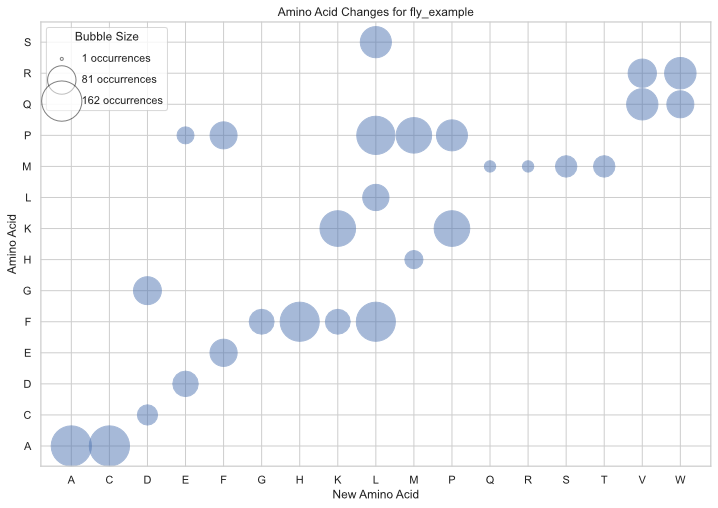
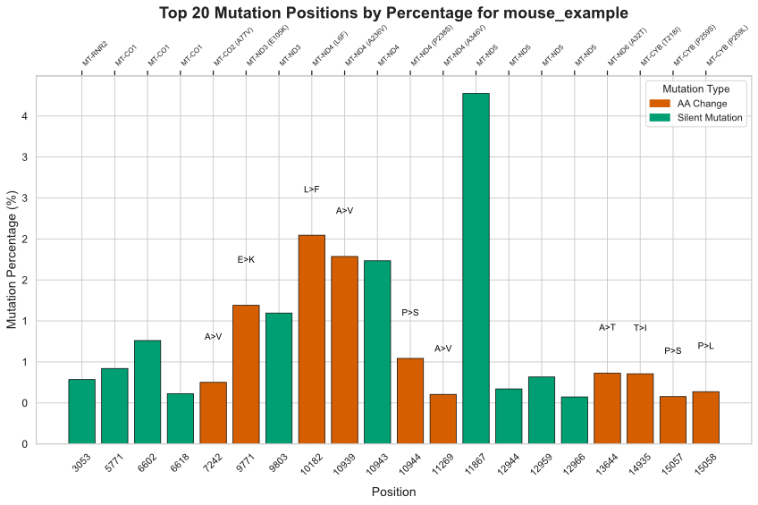
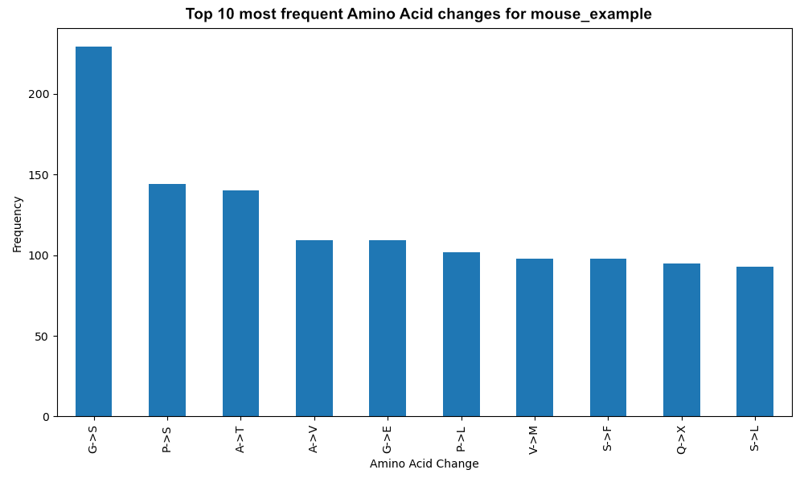
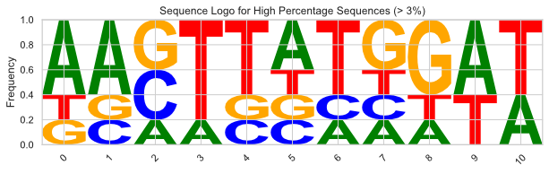

# MitoCAPE

**MitoCAPE** (Mitochondrial Codon Analysis and Plotting) is a Python package for analysing mitochondrial variants and nucleotide editing data and predicting downstream codon and amino acid consequences.

It processes per-position mitochondrial variant/editing data, annotates coding effects, summarises silent vs amino-acid altering changes, and generates publication-ready visualisations.

Developed for mitochondrial genome editing, sequencing analysis, and functional interpretation workflows.

---

<p align="center">
  
  
</p>

---

## Features

- Analyse mitochondrial editing / mutation datasets from CSV input files  
- Supports multiple species:
  - Human (`grch38`)
  - Mouse (`grcm39`)
  - Fly (`NC_024511.2`)
- Predict codon and amino acid consequences
- Classify:
  - Silent changes
  - Amino acid changes
- Generate summary statistics
- Produce high-quality figures automatically
- Command-line interface (CLI)
- Python API for custom workflows
- Bundled internal reference FASTA + gene maps

---

## Installation

Install directly from GitHub:

```bash
pip install git+https://github.com/NextGenSeek/MitoCAPE.git
```
Or clone locally:
```bash
git clone https://github.com/NextGenSeek/MitoCAPE.git
cd MitoCAPE
pip install .
```
---

## Quick Start (Command line)
Run analysis on an input file:
```bash
mitocape --input sample.csv --outdir results --species human
```
Example:
```bash
mitocape --input examples/fly.csv --outdir results --species fly
```

## Quick Start (Python)
```python
from mitocape import run_analysis

results = run_analysis(
    input_file="sample.csv",
    outdir="results",
    species="human"
)

print(results["processed_file"])
print(results["summary"])
```

## Example output
After running:
```bash
mitocape --input sample.csv --outdir results --species fly
```
Outputs may include:
```
results/
├── sample_processed.csv
├── sample_barchart_top10AA_Changes.pdf
├── sample_percentage_barchart_top20_Mutations.pdf
└── sample_amino_acid_changes_bubble_plot.pdf
```

## Input Format
Input files should be CSV tables containing per-position mitochondrial editing or mutation data.

Typical required columns include:
```
position
percentage
reference_base
edited_base
```

## Supported species
| Species | Use with CLI      |
| ------- | ----------------- |
| Human   | `--species human` |
| Mouse   | `--species mouse` |
| Fly     | `--species fly`   |

## Generated Plots
MitoCAPE can generate:
- Top amino acid change barplots
- Most edited mutation positions
- Bubble plots of amino acid substitutions
- Histograms
- Gene-specific editing plots
- Codon effect visualisations

## Example Figures

<p align="center">
  
  
</p>

## Documentation 
Full documentation is available in the [docs](docs/) folder.

## Citation
If you use MitoCAPE in research, please cite:
```
Van Haute L. MitoCAPE: A Python package for mitochondrial codon and amino-acid consequence analysis.
GitHub: https://github.com/NextGenSeek/MitoCAPE
```
